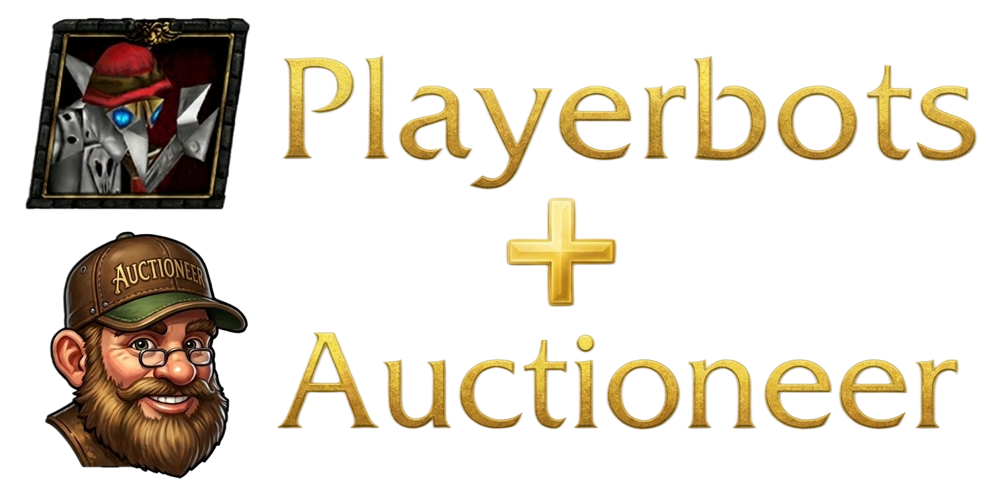

<p align="center">
    <a href="https://github.com/electrobutterfly/azerothcore-wotlk-playerbots">Azerothcore-Playerbots</a>
    |
    <a href="https://github.com/NathanHandley/mod-ah-bot-plus">AH Bot Plus</a>
    |
    <a href="https://github.com/electrobutterfly/mod-playerbots-auctioneer">Playerbots-Auctioneer</a>
</p>
<div align="center">
  
</div>


# Playerbots-Auctioneer

`Playerbots-Auctioneer` is a heavily modified [mod-playerbots](https://github.com/mod-playerbots/mod-playerbots) fork which provides an auction-house and vendor economy for the bot population.

Out of the box, mod-playerbots bots do not interact with the Auction House or with vendors. They do not buy, they do not sell, they do not bid, they do not walk to an auctioneer, they do not collect mail, and they do not dispose of soulbound gear. On a bot-only server the AH is populated by whatever the server operator places there by hand, or by mod-ah-bot-plus if it is enabled — it is not an economy driven by the bot population.

`Playerbots-Auctioneer` gives the bot population a complete economy of its own:

- **Auction house.** Every bot walks to the AH, sells its by-profession crafted goods and surplus inventory, buys items it needs, bids on and defends listings it wants, collects expired mail, and relists returned items — the same lifecycle a human player follows.
- **Vendors.** Every bot periodically walks to a vendor and sells whatever the auction house won't take: soulbound gear, cheap loot, materials below the listing floor. Bots with Enchanting also disenchant soulbound gear before leaving.

The economy runs **autonomously**: no human players are required for the AH to fill up, and the buyer and seller features of mod-ah-bot-plus do not need to be enabled for the bots to trade with each other.

---

## Features

### Auction house

- **Automated selling.** Bots decide which inventory items are worth listing, price them against the live market and (optionally) a reference market, undercut competing listings by a bounded percentage, and list them for a configurable duration.
- **Automated buying.** On a configurable per-cycle chance, bots scan the AH for gear upgrades, larger bags, consumables, profession materials, and quest items they need, and buy or bid up to a willingness threshold.
- **Bid tracking.** Bids placed by bots are persisted. If a bot is outbid, it re-evaluates whether it still wants the item before defending the bid. Items that are no longer useful are dropped instead of chased up to the original cap.
- **Mail collection.** Bots walk to a mailbox when they have returned auction mail, collect the items, and relist them — up to a per-item retry cap, after which the item falls through to the normal vendor or destroy path.
- **Reference pricing.** A per-item price band (`price_low` / `price_median` / `price_high`) sourced from a live market. Because a bot-only economy has no outside liquidity, without a reference the bots race each other to the vendor floor within days. The reference band seeds prices on an empty market, floors undercutting so prices cannot walk into the ground, and caps how many concurrent listings of the same item can exist.
- **Starting-bid ratios.** The observed MINBID/BUYOUT ratio from the reference market, used to set a realistic starting bid instead of always halving the buyout.
- **Craft arbitrage.** When a bot knows a recipe whose output is worth more than its reagent cost at reference prices, the reagents are reserved instead of being dumped at material price. **Off by default** — see the note under *Recommended defaults* below.
- **Multi-snapshot trend.** Prices nudge up or down within the reference band based on how the reference market has moved over a retention window (default 90 days).

### Vendors

- **Surplus disposal.** Every bot periodically visits the nearest vendor on its current map and sells anything classified as vendor trash: soulbound gear it has replaced, cheap materials below the AH listing floor, and loot the AH will not take.
- **Disenchanting.** Bots with Enchanting disenchant soulbound gear before leaving the vendor, keeping the enchanting materials.
- **Bag hygiene.** Because gear and cheap loot exit through the vendor instead of accumulating in bags, bots rarely hit the destroy-under-bag-pressure threshold. This is what keeps the destroy path a genuine safety net rather than a hidden primary disposal.

### Master switches

- **Fully optional.** With the reference tables empty or missing, the auctioneer falls back to legacy pricing with no error spam and no crash. The two modes are selected by a single config key.
- **GM-only commands.** The `ah bid`, `ah sell`, `ah buypick`, and `ah sellpick` chat commands are restricted to Game Master accounts. Non-GM attempts are rejected and logged.

### Relationship with mod-ah-bot-plus

mod-ah-bot-plus is installed as a dependency because the auctioneer's buyer and seller logic is benchmarked against the same `CalculateItemValue` implementation that mod uses. But the AH bot's own buyer and seller features can be independently enabled or disabled — the playerbots-auctioneer provides the buyer and seller behavior for the bot population itself, and works with those features off.

The AH bot GUIDs from mod-ah-bot-plus are used only to classify sellers for the buyer-preference logic (`Playerbots.Auction.AhBotGUIDs`), so the bots know the difference between "another playerbot" and "the dedicated AH bot". If you are not running mod-ah-bot-plus, leave that config key empty and the classification falls back to `Unknown`.

### Bag progression

Bots grow into bags the way real players do: they start with the containers the core grants at character creation and then earn the rest through loot, vendors, the auction house, and their own professions. The behavior is controlled by `Playerbots.RandomBotStarterBagMode`, which lives in `playerbots_auction.conf` (not `playerbots.conf`) so that all overrides to the upstream mod-playerbots defaults sit in one diffable file:

- `1` — historical. Every randomize grants a full set of high-quality bags, regardless of the bot's level or progression. Bots never need to find, buy or craft bags.
- `2` — starter-kit only. A bot keeps the containers its class was created with — the 16-slot backpack every character has, plus whatever the core wrote from the `CharStartOutfitEntry` (four 12-slot bags for Death Knights, a 6-slot quiver for Hunters). Any further bag space must be earned.

Under either mode, three independent subsystems drive bag growth:

**Buy container (vendor and AH).** After a vendor visit's sell and disenchant passes have run, and after an AH visit's sell, mail and bid passes have finished, the bot searches the vendor's stock (or the AH buyout listings) for a bag, quiver or ammo pouch larger than the smallest equipped container, and buys the largest it can afford. Cheapest-price breaks ties within the same size. The action only runs once per visit and skips entirely if the bot cannot pay.

**Craft bags.** Every profession recipe a bot knows that produces a standard bag, quiver or ammo pouch is a crafting candidate at the same priority as useful-item crafts. Tailoring supplies the standard bags (Linen through Frostweave, plus the profession specialty bags); Leatherworking supplies the quivers and ammo pouches. Bag size varies with the bot's skill level, so a fresh server sees 6- and 8-slot bags early and 16-, 18- and 20-slot bags later. Recipes unlock at fixed skill thresholds, so the population's bag supply is a function of its profession progression rather than a fixed grant.

**Equip on loot.** A container in a bot's bags that is strictly larger than its smallest equipped bag (or any container if a bag slot is empty) is classified as a gear upgrade. `EquipAction` swaps it into the appropriate slot and the displaced container returns to bags, where the sell pipeline eventually picks it up. Hunters can upgrade their quivers, and pouches are treated the same as bags for them. Bag slots fill left-to-right starting at slot 19; on equal sizes, the first such slot wins, so replacements also march left-to-right.

Every bag equip, purchase and swap emits a `[BAG]` line to the log. See the *Troubleshooting* document for the log format and grep recipes.

### Altbot auction-house block

`Playerbots.Auction.AllowAltBots` (default `0`) controls whether altbots and addclass bots are allowed to visit an auctioneer under automation.

"Altbot" in this context means a bot whose current master is a real player or a selfbot, and which is not a randombot and not itself a selfbot. That covers characters on the player's own accounts and bots drawn from the AddClass account pool. It does **not** cover randombots that happen to be in a player's group — those continue to use the auction house normally.

When `0`, such bots are excluded from the AH automation pipeline entirely. They still visit vendors for selling, repair, disenchanting and bag purchases. Only the auction house is blocked.

**The reason this defaults to `0` is abuse prevention.** A player can log in a batch of altbots, leave them unattended, and let them farm the auction house on the player's behalf — earning gold, cornering markets, and competing with other players, all without any manual input. That undercuts the "no unattended automation for player accounts" principle the rest of the module is built around. Setting the key to `0` closes that avenue at the automation level, while still allowing a player who *is* at the keyboard to use the AH through their altbots by flipping the key to `1` on the server, or by acting as the altbot's master in a selfbot capacity. Randombots are unaffected by this key.

Server operators who are comfortable with the tradeoff can set this to `1`.

### Bots sometimes seem to "fly or go through wall"

That is not an issue of playerbots-auctioneer but the underlying [mod-playerbots](https://github.com/mod-playerbots/mod-playerbots).

---

## Installation


> [!WARNING]
>
> ## ⚠ COMPATIBILITY WARNING ⚠
>
> **You MUST clone the AzerothCore fork linked below. Do NOT clone the upstream
> `mod-playerbots/azerothcore-wotlk` repository.**
>
> This module is a heavily modified fork of `mod-playerbots`, and it depends on
> specific commits that only exist in the fork below. The upstream
> `mod-playerbots` repository is updated on its own schedule and is frequently
> out of sync with this module's expectations. **If you clone upstream and then
> clone this module into `modules/`, the module will not compile** — the
> interfaces it depends on (`PlayerbotAIConfig`, `NewRpgInfo`, `TravelMgr`,
> `ItemUsageValue`, and others) diverge between the two repos.
>
> The fork below tracks `mod-playerbots` and is updated alongside this module,
> so it always contains the exact commit the module expects.


### 1. AzerothCore Playerbots

Clone the AzerothCore playerbots fork:

```bash
git clone https://github.com/electrobutterfly/azerothcore-wotlk-playerbots.git
```


### 2. Modules

The auctioneer depends on the mod-ah-bot-plus module. Install both inside the `modules/` directory:

```bash
cd azerothcore-wotlk-playerbots/modules

# Playerbots-Auctioneer — the auction-house and vendor subsystem (this module)
git clone https://github.com/electrobutterfly/mod-playerbots-auctioneer.git

# AH Bot Plus — the auction-house bot mod the auctioneer is benchmarked
# against. Pinned to a specific revision for compatibility.
git clone https://github.com/NathanHandley/mod-ah-bot-plus.git
cd mod-ah-bot-plus
git checkout f685832994c825f90aa5a3dc0e1620aa568e875b
cd ..
```


### 3. Build and install

Build the worldserver following the standard AzerothCore build process. Everything the auctioneer needs is compiled in automatically — there is no separate build step and no extra CMake target.

### 4. Configuration

Copy the distribution config to its live name and edit it:

```bash
cd env/etc/modules
cp playerbots_auction.conf.dist playerbots_auction.conf
$EDITOR playerbots_auction.conf
```


The two settings you **must** change to enable the feature:

```bash
Playerbots.Auction.Enabled = 1
Playerbots.Auction.Baseline.Mode = 2
```


`Auction.Enabled` is the master switch for both the AH and vendor subsystems. `Baseline.Mode = 2` tells the bots to consult the reference table rather than falling back to legacy pricing. Both are safe to change at any time; `.reload config` applies them without a restart.

The full file is documented inline. Every setting has a comment describing what it does, what values it accepts, and what the default means. See the *Recommended defaults* section below for the settings a fresh install should consider changing after the first day of operation.

### 5. Configure the baseline tool

The baseline pipeline ships inside the module. Its config example lives at `auctioneer_baseline/auctioneer.conf.example`. Copy it, edit the database credentials, and set an absolute path for `work_dir`:

```bash
cd modules/mod-playerbots-auctioneer/auctioneer_baseline
cp auctioneer.conf.example auctioneer.conf
$EDITOR auctioneer.conf

sudo mkdir -p /var/lib/auctioneer-baseline
sudo chown $USER /var/lib/auctioneer-baseline
```


The config has five sections:

- `[mysql]` — shared defaults for the two database connections below.
- `[world]` — read-only. Used to read `item_template` for the item filter and the (class, quality) classification.
- `[character]` — read-write. Where the baseline tables live.
- `[source]` — the Auctioneer mirror URL. Change this only if you point at a different realm.
- `[paths]` — where the tool downloads files and writes its intermediate SQL. Use an absolute path; a relative path resolves against the process working directory, which is unpredictable under cron.

`[world]` and `[character]` each inherit any value not set from `[mysql]`. If your world and character databases live on the same host under the same user, set it once in `[mysql]` and leave the two specific sections with only the `database` key set. If they live on different hosts or under different users, override them individually — the tool uses two fully independent MySQL connections and never assumes they share credentials.

### 6. Seed the baseline

Create the tables (idempotent — safe to run more than once, and only needed if your install does not apply them automatically):

```python
python3 auctioneer.py schema | mysql -u acore -p acore_characters
```


Run the full pipeline once by hand:

```python
python3 auctioneer.py run
```


This downloads both faction Lua files (~30 MB total), parses them, filters to items present in your `item_template`, computes per-item stats, writes `baseline.sql`, and pipes it into `acore_characters`. Takes 30–60 seconds and 200–500 MB peak memory.

When it finishes, the reference tables are populated and the running worldserver will pick them up on its next reload check — no restart needed.

### 7. Schedule the baseline refresh

The bundled baseline is a snapshot in time. To keep it fresh, run the Python tool on a timer. It can run while the worldserver is up — the running server notices new data within `Baseline.ReloadCheckMinutes` and reloads its in-memory caches without a restart.

*Option A — systemd (recommended):*

```bash
cd modules/mod-playerbots-auctioneer/auctioneer_baseline
sudo cp systemd/auctioneer.service systemd/auctioneer.timer /etc/systemd/system/
sudo systemctl daemon-reload
sudo systemctl enable --now auctioneer.timer
```


*Option B — cron:*

```bash
cd modules/mod-playerbots-auctioneer/auctioneer_baseline
sudo cp cron/auctioneer.cron /etc/cron.d/auctioneer
```


Both fire the same command every 12 hours. 12 hours matches how often the source mirror updates — running more often than that is wasted bandwidth.

If you placed the tool directory somewhere other than the module tree, edit the `ExecStart=` line in the systemd unit (or the command line in the cron file) to match. The README inside `systemd/` and `cron/` documents the two variables you might need to change: the path to the tool and the path to the config file.

### 8. Verify the install

Three quick checks:

```bash
# 1. Tables exist and have data
mysql -u acore -p acore_characters -e \
  "SELECT COUNT(*) AS items FROM auctioneer_baseline_item; \
   SELECT COUNT(*) AS categories FROM auctioneer_baseline_category;"

# 2. The worldserver loaded them at boot
grep 'auctioneer baseline' logs/Playerbots.log

# 3. Bots are visiting the AH
grep '\[AH-TRACE\]' logs/Playerbots.log | tail -20
```


If (1) shows zero rows, run `python3 auctioneer.py run` once by hand and recheck.

If (2) shows nothing, the config has `Baseline.Mode = 1`. Set it to `2` and reload.

If (3) shows nothing, either `DebugAuction` is off (see *Troubleshooting*) or the bots are not choosing AH visits — check `RpgStatusProbWeight.GoAuctioneer` and the visit gates in the config.

------

## 9. Troubleshooting

See [TROUBLESHOOTING](TROUBLESHOOTING.md/) for the diagnostic mode, log formats, grep recipes, and the diagnostic bundle to attach to bug reports.

------

## Recommended defaults

The shipped defaults are chosen so that a fresh install works out of the box. The list below is what is recommended you **change** after the first 24 hours of operation, once you have seen how your server behaves:

| Setting                                  | Default | Recommended after first 24h                             | Why                                                          |
| :--------------------------------------- | :------ | :------------------------------------------------------ | :----------------------------------------------------------- |
| `Auction.Baseline.CraftArbitrageEnabled` | 0       | leave at 0 unless you have tested it                    | When enabled, a bot that knows a profitable recipe will hold its reagents back from the AH. If the margin threshold is wrong for your server, reagents accumulate in bags and never get listed. Off by default. |
| `Auction.MaxSellsPerVisit`               | 5       | raise to 10 on a small server, leave at 5 on a busy one | Governs how many fresh items a bot lists in a single AH visit. Higher = faster AH fill, more burst load. |
| `Auction.BuyScanChancePercent`           | 10      | raise to 25 if you want more buying                     | Each buy scan iterates every AH listing. This is the single most expensive operation in the subsystem. |
| `Auction.MaxSpendPercentPerVisit`        | 25      | raise to 50 if bots seem cash-rich                      | Caps how much of a bot's gold goes into one visit. 25% keeps bots solvent. |
| `Auction.MinSellValueCopper`             | 25      | raise to 100 if the AH fills with junk                  | 25c lets mid-tier materials and cheap greens reach the AH. 100c filters them out. |
| `Auction.MaxRelistRetries`               | 3       | leave at 3                                              | How many times a bot relists the same returned item before giving up. |
| `Auction.Baseline.ReloadCheckMinutes`    | 60      | raise to 240 if you run the parser weekly               | Frequency the worldserver polls for a new baseline snapshot. Cheap; a minute is fine on any server. |

**Do not raise `Auction.MinSellQuality` above 1.** Herbs, ore, leather, cloth and most trade goods are quality 1 (white). Raising it stops bots selling their gathered materials, which is a large fraction of the AH.

**Do not raise `Auction.Baseline.CraftMarginPercent` above ~20 unless you know what you're doing.** Anything above 20% will start reserving reagents for crafts that never fire, and those reagents will accumulate in bot bags.

------

## How the baseline works

Because a bot-only economy has no outside liquidity, the bots on a fresh server would otherwise price everything from `vendor × 5` and walk the market for each item down to the vendor floor within days. The baseline gives them a **reference market** to price against — a per-item price band sourced from a live Auctioneer scan of a large, mature realm.

The tool downloads two SavedVariables dumps (one per faction), parses out per-item price, stack-size, listing-count and bid-ratio statistics, and writes them into three tables in `acore_characters`:

- **`auctioneer_baseline_item`** — one row per `(faction, item_id, suffix)`. Carries the price band, stack statistics, listing depth, bid ratio, and multi-snapshot trend. This is the table the C++ side reads.
- **`auctioneer_baseline_category`** — one row per `(faction, class, quality)`. Describes how many auctions of a given item class and quality are live on the reference market at once. Used by the sell path to keep the local market's category mix looking real.
- **`auctioneer_baseline_history`** — one row per `(faction, item_id, suffix, snapshot_time)`. Every refresh appends a new row. The trend column on the item table is computed from the oldest retained history row vs. the current run. Rows older than the retention window are pruned on each refresh.

### What the C++ side does with it

When a bot is about to list an item, it looks up the baseline row for the `(faction, item_id, suffix)`. If found and the sample size is sufficient:

- The listing price is **drawn from the reference band** — a triangular distribution across `[price_low, price_high]` peaking at `price_median` — rather than falling through to `vendor × 5`. Different bots list at different prices, and the AH looks like a real market instead of a wall of identical listings.
- The result is **floored at `price_low`** so no undercut can walk it below the bottom of the reference band.
- The result is **capped at `price_high`** so no bot lists at an unreasonable price on a thin-sample item.
- The **starting bid** is set to the reference MINBID/BUYOUT ratio (per-item when the sample is reliable, class-level otherwise).
- The **number of concurrent listings** for that item is capped at the reference's typical depth, so one bot population cannot flood the AH with the same item.
- The **trend column** nudges the draw up or down within the band based on how the reference market has moved.

Every step degrades gracefully: if a row does not exist for a given item, the bot falls through to legacy behavior for that item only. If the whole table is missing, every bot falls through. There is no hard dependency at any point.

### Freshness

The worldserver polls the baseline table every `Baseline.ReloadCheckMinutes` (default 60). The poll is a single-row aggregate query on a small table and costs microseconds. When the newest snapshot tag differs from the currently loaded one, the worldserver re-reads both tables in place — a few hundred milliseconds — and the bots use the new values on their next AH decision. No restart, no service interruption, no bot state reset.

------

## Configuration reference

The full configuration file lives at `modules/mod-playerbots-auctioneer/conf/playerbots_auction.conf.dist` (path depends on where the module was cloned), but it should automatically be copied to its server configuration into the modules directory when you run `make install` after compiling the core. Every setting has an inline comment describing what it does, what values it accepts, and what the default means. The most commonly tuned settings:

| Setting                                       | Purpose                                                 |
| :-------------------------------------------- | :------------------------------------------------------ |
| `Auction.Enabled`                             | Master switch for the whole subsystem                   |
| `Baseline.Mode`                               | 1 = legacy pricing, 2 = reference pricing               |
| `Auction.VisitMinMinutes` / `VisitMaxMinutes` | How often each bot returns to the AH                    |
| `Auction.MinSellQuality`                      | Lowest item quality that will be listed                 |
| `Auction.MinSellValueCopper`                  | Lowest vendor sell price that will be listed            |
| `Auction.SellUndercutPercentMin` / `Max`      | How aggressively bots undercut live listings            |
| `Auction.BuyScanChancePercent`                | Chance per RPG cycle that a bot scans the AH for buys   |
| `Auction.MaxActiveListingsPerBot`             | Per-bot cap on concurrent listings                      |
| `Auction.MaxSellsPerVisit`                    | Fresh listings per AH visit                             |
| `Auction.AllowBuyout`                         | Whether bots buy out auctions or only bid               |
| `Baseline.ReloadCheckMinutes`                 | How often the running server checks for a new baseline  |
| `Baseline.CraftArbitrageEnabled`              | Reserve reagents for profitable crafts (off by default) |
| `RpgStatusProbWeight.GoVendor`                | How often bots pick a vendor visit                      |
| `VendorVisit.MinBagFillPercent`               | Bag pressure that triggers a vendor visit               |
| `RandomBotStarterBagMode`                     | 1 = grant full bags on randomize, 2 = start with class defaults and earn the rest |
| `Auction.AllowAltBots`                        | Allow altbots and addclass bots to use the AH           |

### Modes explained

`Baseline.Mode` is the single switch that decides whether the reference table is consulted at all:

- **`1`** — legacy. Pricing is driven entirely by the local market: the cheapest live listing for the item, undercut by a bounded percentage, floored at vendor price. Starting bids are always `buyout / 2`. This is the behavior that shipped before the reference tables existed.
- **`2`** — reference. The bot consults the baseline for the item. If a row exists and is not too thin, prices are drawn from the reference band, floored and capped, startbids come from the observed ratio, and the concurrent listing cap applies. If no row exists (item never seen on the reference market), the bot falls through to Mode 1 behavior for that item only.

Mode 2 is a superset of Mode 1. There is no scenario where Mode 2 is worse than Mode 1, and no scenario where it breaks: with an empty baseline table, Mode 2 behaves exactly like Mode 1.

------

## The baseline tool in detail

### Commands

The Python tool has six subcommands:

| Command    | What it does                                              |
| :--------- | :-------------------------------------------------------- |
| `run`      | Full pipeline: download, parse, write SQL, insert         |
| `download` | Download both Lua files to `work_dir/scans/`              |
| `parse`    | Parse the Lua files, write `work_dir/baseline.sql`        |
| `insert`   | Pipe `work_dir/baseline.sql` into the character database  |
| `schema`   | Print the `CREATE TABLE` statements (for a fresh install) |
| `clean`    | Remove `work_dir/scans/*.lua` and `work_dir/baseline.sql` |

`run` is what the timer should call. The other five exist so you can break the pipeline apart for debugging — for example, run `parse` alone and inspect `baseline.sql` before committing it to the database.

### What `parse` produces

The intermediate `baseline.sql` file is a self-contained SQL script: `START TRANSACTION`, `DELETE FROM` both target tables, chunked `INSERT`s for the new data, `INSERT IGNORE` for the history append, an old-history prune, and `COMMIT`. Running it against `acore_characters` is transaction-safe — if any part fails, the whole thing rolls back and the previous baseline stays live.

### The two MySQL connections

The tool uses two independent connections:

- **`[world]`** — read-only. One query: `SELECT entry, class, Quality FROM item_template`. This is the source of the item filter (only items your realm actually has are imported) and the (class, quality) classification used by the category table.
- **`[character]`** — read-write. Where the baseline tables live. The tool never touches `acore_world` beyond the one `item_template` read, and never touches `acore_playerbots` at all.

They can be the same user or different users, on the same host or on different hosts. The config handles every combination through the inheritance mechanism described in section 5 above.

------

## Contributing and Troubleshooting

[Issues](https://github.com/electrobutterfly/mod-playerbots-auctioneer/issues) and [pull requests](https://github.com/electrobutterfly/mod-playerbots-auctioneer/pulls) are welcome. When filing a bug against the auctioneer specifically, please attach the diagnostic bundle described in [TROUBLESHOOTING](TROUBLESHOOTING.md).

------

## Acknowledgements

The baseline data format and the price-band approach are adapted from [mod-auctionsim](https://github.com/liyunfan1223/mod-auctionsim)'s Replay mode and its `compile-data.cpp` reference implementation. The scan data itself is pulled from the public Auctioneer mirror at `ah.nerfed.net`.

The seller and buyer pricing comparison logic is built against [mod-ah-bot-plus](https://github.com/NathanHandley/mod-ah-bot-plus), which provides the reference `CalculateItemValue` implementation that this subsystem benchmarks against.

The auction-house subsystem builds on the movement, chat, and personality infrastructure of [mod-playerbots](https://github.com/mod-playerbots/mod-playerbots), without which none of this would be possible.

[Here](AUTHORS-OLD.md) you will find all the authors involved in the development of the original module.

------

## Also check my other modules:

### mod-afk-kicker

A module that automatically kicks players who remain AFK (Away From Keyboard) for longer than a configurable duration, useful for high-population servers where inactive sessions consume player slots, memory, and CPU.

[mod-afk-kicker for AzerothCore-wotlk](https://github.com/electrobutterfly/mod-afk-kicker)

[mod-afk-kicker for TrinityCore 3.3.5](https://github.com/electrobutterfly/trinitycore-afk-kicker)


### mod-ip-limiter

A module that limits how many players may connect from a single IP address. When the limit is exceeded, every player from that IP is kicked. Specific IP addresses (e.g. internet cafés, LAN parties, or your own office) can be whitelisted and exempted from the limit.

[mod-ip-limiter for AzerothCore-wotlk](https://github.com/electrobutterfly/mod-ip-limiter)

[mod-ip-limiter for TrinityCore 3.3.5](https://github.com/electrobutterfly/trinitycore-ip-limiter)

------

Copyright (C) 2026, Klaus Simon aka Electrobutterfly


